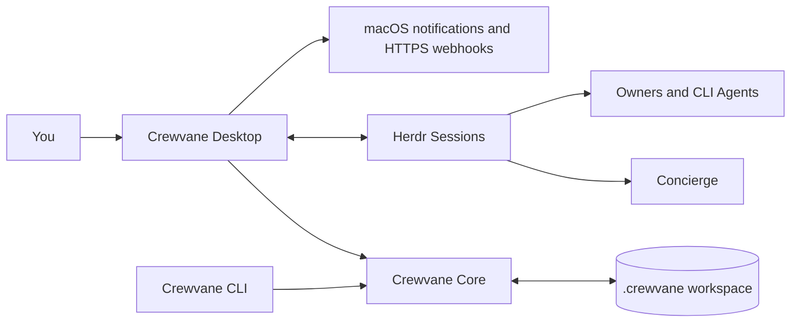

<div align="center">


# Crewvane

**The attention layer for parallel AI work.**

One workspace. Many projects. One concierge. Only what needs you reaches you.

[简体中文](README.zh-CN.md) · [Download](https://github.com/gdli6177/crewvane/releases/latest) · [Documentation](docs/crewvane.md) · [Architecture](docs/ARCHITECTURE.md)

[](https://github.com/gdli6177/crewvane/releases)
[](docs/releases.md)
[](LICENSE)
[](https://github.com/gdli6177/crewvane/actions/workflows/desktop-release.yml)

</div>


Crewvane is an open-source macOS desktop app for one person working with many
projects and many CLI coding agents at the same time.

It gives every project and personal task a persistent home, routes execution
through a single concierge agent in [Herdr](https://github.com/herdrdev/herdr), and brings only
decisions, reviews, due follow-ups, and genuine interventions to your attention.
The regular work in between stays out of your way.

Crewvane does not replace Codex, Claude Code, OMP, Cursor, Qoder, or another agent.
It works with interactive CLI agents that can already run in a terminal, keeps
the terminal sessions in Herdr, and adds the durable workflow around them:
state, ownership, waiting, evidence, approvals, and recovery.

> **Status:** early preview (`0.6.x`). The desktop UI is currently in Simplified
> Chinese and the packaged app supports macOS on Apple Silicon.

## Why Crewvane

AI agents made it possible to run more work in parallel. They also created a new
kind of overload: too many sessions, invisible waits, and context switching every
time you try to remember what is happening where.

Crewvane changes the unit of work from **terminal session** to **goal**.

| Without a coordination layer | With Crewvane |
| --- | --- |
| You monitor a growing list of terminal tabs. | You scan one attention center. |
| A finished-looking agent may be mistaken for finished work. | Delivery requires evidence and human acceptance. |
| Important context lives in chat history. | Goals keep the original request, attachments, messages, waiting state, and handoffs. |
| "Done" means whatever the current session says. | `idle` or `done` is runtime state, not completion. |
| Approvals are repeated from memory. | A decision ledger reuses explicit human decisions. |
| Every project invents its own inbox. | One workspace has one concierge and one source of truth. |

## What it does

### One workspace, one concierge

All projects and personal tasks live in the same workspace. A single persistent
`concierge` agent receives new goals, reads their complete context, and delegates
actual execution to independent owners. The concierge coordinates; it does not
quietly take over the work.

### Capture first, decide when to start

The same input can save an idea for later, record something you will do yourself,
or hand it to the concierge. The task pool keeps deferred work out of execution
and stall checks. Personal tasks can be completed directly, with optional reminders
in the attention panel. Delegating later preserves the original record, project,
images, and history.

### Attention instead of activity

The attention panel is intentionally narrow. It shows work when:

- you must make an explicit decision;
- an owner has submitted a deliverable for review;
- a waiting item has reached its follow-up time;
- a policy or high-risk action needs approval; or
- a live agent needs a real intervention that coordination could not resolve.

Ordinary progress, a busy terminal, an idle agent, or a chat reply does not
become an attention item.

When a waiting item is due, the card asks for one plain-language update. The
concierge reads that message and decides whether to keep waiting, resume,
submit for review, complete, or drop the goal. The only separate shortcut is
“remind me in one hour”; completion and decisions remain auditable against the
user's exact words.

### Bring your own agent

Configure the launch command and native arguments for the concierge, owners, and
workers. A command such as `codex --model my-model`, an absolute script path, or
another interactive CLI can be used directly. Crewvane does not own model keys,
proxy API calls, or replace the agent runtime.

Herdr provides the persistent terminal sessions and agent communication layer.
The desktop app includes its own verified Herdr binary, and the optional Herdr
plugin adds attention, one-line goal intake, and concierge shortcuts inside
Herdr.

### Evidence before completion

A goal can be accepted only after an owner submits:

- a concrete result summary;
- a location or URL when applicable; and
- at least one real check that was actually executed.

The terminal scrollback stays in Herdr. It is not silently copied into agent
context or treated as proof of completion.

### Human control at hard boundaries

Each project has a shipping policy, with external approval as the default.
Crewvane returns an authorization decision; it does not merge, deploy, or send
external messages on its own.

Nine categories always require an explicit human decision, even for projects set
to automatic shipping:

1. deleting data;
2. stopping a service;
3. spending money;
4. sending an external message;
5. changing product direction;
6. creating a secret;
7. rotating a secret;
8. changing permissions; or
9. changing the shipping policy.

These categories are an application-level protocol check in Crewvane's core,
not an operating-system sandbox. A third-party agent's file and network
permissions still come from its own CLI.

### Local-first by default

Goals, messages, attachments, decisions, and events are stored under
`.crewvane/` in the workspace you choose. The desktop app and CLI share the same
locked, atomically written state.

An optional HTTPS webhook can notify Feishu, Lark, WeCom, or another endpoint when
an item first needs attention. The webhook consumes a small read-only event; it
does not write back to the goal or upload message history and attachments.

## How it works



The key boundary is that messages and state changes are separate:

- `goal.message`, `ask`, and `direct` add human-authored facts;
- explicit commands such as `progress`, `wait`, `review`, and `resolve` change
  workflow state;
- Herdr lifecycle events update whether a real agent site is reachable; and
  they never declare a goal completed.

## Install

### Packaged app

Download the latest installer from
[GitHub Releases](https://github.com/gdli6177/crewvane/releases/latest):

- `Crewvane-<version>-macOS-arm64.dmg`
- `Crewvane-<version>-macOS-arm64.zip`
- `SHA256SUMS.txt`

Open the DMG, drag **Crewvane.app** into **Applications**, then launch it. The
packaged app includes Electron, the Crewvane CLI runtime, and a verified Herdr
binary; Node.js and Homebrew are not required for normal installation.

Your agent CLIs still need to be installed and authenticated separately. Crewvane
uses the commands you configure and does not read their credentials.

The current package is ad-hoc signed but not notarized by Apple. macOS may show
“cannot verify the developer” on first launch. Verify the GitHub source and
SHA-256 before using the system prompt to open it. If macOS reports that the app
is damaged, redownload the latest release instead of bypassing Gatekeeper.

### First run

1. Choose a dedicated workspace directory.
2. Open **Settings**, install the Crewvane CLI and optional Crewvane Skills, then
   configure the agent launch command for the concierge, owner, or worker.
3. Prepare the concierge.
4. Click **New goal**, describe the work in natural language, and attach
   screenshots if useful.

See the [user guide](docs/crewvane.md) and
[installation and release notes](docs/releases.md) for the complete workflow.

## CLI

The desktop app installs a workspace-aware CLI at `~/.local/bin/crewvane`.
Use `CREWVANE_WORKSPACE` or `--root` to select the workspace.

```sh
export CREWVANE_WORKSPACE="$HOME/Crewvane"

crewvane status
crewvane ask "Audit the release workflow and attach the evidence"
crewvane ask "Fix this layout" \
  --attachment "$HOME/Desktop/before.png" \
  --attachment "$HOME/Desktop/after.png"

crewvane attention
crewvane attention --json
crewvane goal list
crewvane goal show <goal-id> --json
crewvane board
```

Agent-facing state commands are deliberately explicit. For example:

```sh
crewvane goal progress <goal-id> \
  --summary "Implemented the change and ran the regression suite" \
  --next "Submit the release candidate for review"

crewvane goal review <goal-id> \
  --summary "Installer and CLI verification completed" \
  --check "Installer smoke::pnpm test:installers::passed::ZIP and DMG passed"
```

Run `crewvane --help` after installation to see the complete protocol.

## Project structure

```text
apps/desktop/       Electron shell, React UI, in-app Herdr terminal, plugin
packages/core/      Goals, attention, policy, storage, attachments, recovery
cli/                Human commands and explicit agent state protocol
skills/             Packaged crewvane skill; ship-* skills are legacy
scripts/            Desktop, Herdr, onboarding, and installer acceptance tests
docs/               Product specification, architecture, QA, and release notes
```

## Development

Requirements:

- macOS on Apple Silicon
- Node.js 22 for the current CI environment
- pnpm `10.4.1`

```sh
git clone https://github.com/gdli6177/crewvane.git
cd crewvane
pnpm install --frozen-lockfile

pnpm typecheck
pnpm test
pnpm desktop:dev
```

Build and verify a signed desktop bundle:

```sh
pnpm desktop:dist
pnpm test:desktop
pnpm test:installers
pnpm test:onboarding
```

`test:onboarding` downloads a verified Herdr release and exercises a real
packaged app with an interactive custom CLI. It does not require a model login.

## Current limits

- macOS Apple Silicon only; Windows, Linux, Intel Macs, and mobile are not
  packaged yet.
- The desktop UI is currently Simplified Chinese.
- This is an early preview; storage and CLI details may evolve.
- Crewvane is not a model gateway, scheduler, runtime manager, or hosted service.
- Crewvane coordinates goals and agent sites but does not sandbox third-party
  agents. Agent file access and network permissions remain governed by that CLI.
- Herdr is required for agent execution. Planning, records, reminders, and manual
  review remain readable if Herdr is temporarily unavailable.

## Contributing

Issues and focused pull requests are welcome.

For a substantial feature, open an issue first so the change can be checked
against Crewvane's product boundaries: one concierge per workspace, explicit
state over prompt parsing, evidence before acceptance, and local-first data.

Before opening a pull request:

```sh
pnpm typecheck
pnpm test
```

Desktop or installer changes should also run the relevant end-to-end checks
above. Do not commit workspace data, credentials, attachments from real users, or
generated release artifacts.

## License

Crewvane is released under the [MIT License](LICENSE).
