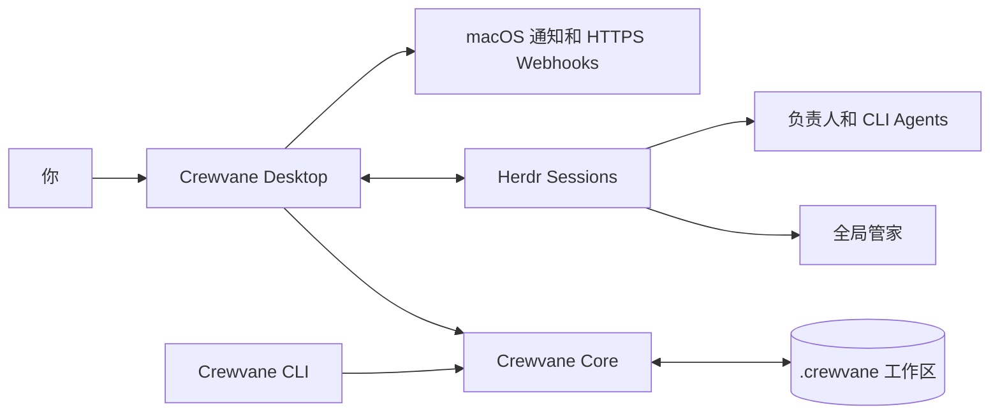

<div align="center">


# Crewvane｜协航

**给并行 AI 工作装上一层注意力。**

一个工作区，多个项目，一位管家。只有真正需要你的事，才会来到你面前。

[English](README.md) · [下载](https://github.com/gdli6177/crewvane/releases/latest) · [使用说明](docs/crewvane.md) · [架构](docs/ARCHITECTURE.md)

[](https://github.com/gdli6177/crewvane/releases)
[](docs/releases.md)
[](LICENSE)
[](https://github.com/gdli6177/crewvane/actions/workflows/desktop-release.yml)

</div>


Crewvane 是一个开源 macOS 桌面应用，面向同时处理多个项目、多个 CLI
Agent 会话的人。

它为每个项目和个人事项保留持久的记录，通过
[Herdr](https://github.com/herdrdev/herdr) 中唯一的全局管家统筹执行，只把需要决定、
验收、到期跟进和真正需要介入的事放进注意力面板。普通的推进过程留在后台，
不再逼你逐个盯着终端。

Crewvane 不替代 Codex、Claude Code、OMP、Cursor、Qoder 等 CLI Agent。已经能在
终端中运行的交互式 Agent，都可以作为工作现场接入。Crewvane 为这些现场补齐
持久目标、负责人、等待、证据、审批和恢复机制。

> **当前状态：** 早期预览版（`0.9.x`）。桌面界面目前为简体中文，安装包支持
> macOS Apple Silicon。

## 为什么需要 Crewvane

Agent 让工作可以并行，也带来了新的负担：会话越来越多，等待不可见，每次切换
都要重新想起“这件事做到哪了”。

Crewvane 把工作单位从**终端会话**变成**目标**。

| 直接管理 Agent 会话 | 使用 Crewvane |
| --- | --- |
| 自己盯着不断增长的终端 Tab | 只扫一眼注意力中心 |
| 把 Agent 结束工作误当成交付完成 | 交付必须有证据，并经过独立复核或人工验收 |
| 重要背景散落在聊天记录中 | 目标保留原文、图片、消息、等待状态和交接记录 |
| “完成”取决于当前会话的说法 | `idle` 或 `done` 只是运行时状态，不等于完成 |
| 相同的审批靠记忆反复处理 | 决定账本复用明确的人类决定 |
| 每个项目各建一套待办和收件箱 | 一个工作区，一位管家，一份事实来源 |

## 它能做什么

### 一个工作区，一位管家

所有项目和个人事项进入同一个工作区。唯一的持久 `concierge` 接收新目标，读取完整
背景，再把实际执行交给独立负责人。管家负责协调、跟进和交接，不会把本该分发的
工作悄悄拿回来自己做。

### 先记下，或留给自己做

同一个输入框可以选择“先记下”“我来做”或“交给管家”。还没准备开始的想法留在待办池，
不会启动 Agent 或被催办；个人待办由你安排，做完直接标记完成。需要时设一个提醒，
到期再进入注意力；准备好交给管家时，沿用原记录、项目、图片和历史。

### 关注真正重要的事

注意力面板只保留真正需要人的事：

- 需要你明确作出决定；
- 负责人已提交成果，等待你验收；
- 等待事项到达跟进时间；
- 上线策略或高风险动作需要审批；或
- 真实 Agent 现场需要介入，协调已无法解决。

普通进展、终端忙碌、Agent 空闲或聊天回复，都不会单独进入注意力。

### 自主目标，人保留最终裁决

一个目标可以带结构化委托摘要，写明结果、范围、完成条件、外部影响和验证方式。
Crewvane 会在 Agent 会话之外持久保存短回合续跑：checkpoint、外部等待、失败恢复、
独立复核和人工决定都能跨重启继续，不依赖某个 Agent 一直驻留。

自动验收默认关闭，授权按“目标覆盖 > 项目设置 > 工作区默认”解析。只有真实证据、
匹配的候选版本和独立复核全部通过门禁，系统才会自动完成交付。你随时可以暂停、
改为人工验收、查看完整记录或重新打开目标。

生产发布是独立目标，每次都要针对环境和候选版本单独批准；执行结束后仍会回到你
面前核对真实结果。交付验收不会自动变成发布许可。

本地 Bot 可以通过 `crewvane.bot.v1` 使用同一份目标和事件事实。绑定由人创建、
限定项目并可撤销；首期 Bot 不能验收、批准发布或修改策略。

完整的边界、验收、续跑与发布协议见
[自主目标规格](docs/product/autonomous-goals.md)。

等待事项到点后，卡片只要求你用一句自然语言说明现状。管家读取原话后判断继续
等待、恢复推进、提交验收、完成还是放弃；唯一的独立捷径是“1 小时后提醒”。
完成、放弃和审批都会保存你的明确原话，普通顺承词不会被猜成状态变更。

### 使用你已经安装的 Agent

分别配置管家、负责人和工人的启动命令与原生参数，例如
`codex --model my-model`、绝对脚本路径或其他交互式 CLI。Crewvane 不管理模型密钥，
不代理模型 API，也不替换 Agent 运行时。

Herdr 提供持久终端会话和 Agent 通信。桌面应用自带经过校验的 Herdr 二进制文件；
可选的 Herdr 插件还能在终端内打开注意力、用一句话新建目标、直接回到全局管家。

### 工作现场由你熟悉的终端承载

“回到现场”默认在 iTerm2、Terminal 或 Ghostty 中打开同一个 Herdr Session，
保留原生组合键、图片粘贴、输入法和终端行为。Crewvane 会复用已有窗口，并在设置
中记住终端偏好。也可以切换到内嵌轻现场快速查看；其中的目标事实与外部终端完全
共用同一份 Herdr 现场。仅粘贴图片时，轻现场会把一次 `Ctrl+V` 交给当前 Agent，
由 Agent 自己读取系统剪贴板。

### 即时生命周期，明确业务决定

Crewvane 会检测 Codex、Claude Code、Cursor、Qoder 和 OMP，并为提供官方接入能力的
Agent 安装受管生命周期 Hook。事件通过私有本地 Socket 即时进入应用；应用未运行时
进入有期限和数量上限的离线队列。用户已有的 Hook 与其他 OMP extension 会完整保留，
Codex 仍要求在它自己的 `/hooks` 界面中审核并信任新条目。

Hook 只证明会话或回合状态发生了变化，绝不会把目标标成完成、等待第三方、可验收或
允许外部动作。这些业务事实仍只由 Crewvane 语义 CLI 写入。回合结束后，Crewvane
会短暂等待结构化写回；缺失时只提醒同一负责人一次，再由管家核对。Agent 没有兼容
Hook 时，Herdr 和原有 Watchdog 继续完整兜底。

### 有证据，才算完成

目标验收前，负责人必须提交：

- 具体成果摘要；
- 可访问的交付位置或链接（如适用）；以及
- 至少一项真实执行过的检查。

终端滚动记录留在 Herdr，不会被悄悄复制进 Agent 上下文，也不会被当成交付证明。

### 关键边界由人掌握

每个项目都可以配置上线策略，默认需要外部审批。Crewvane 只返回策略是否放行，
不会替你合并、部署或向外发送消息。

即使项目设为自动上线，以下九类动作仍必须由人明确决定：

1. 删除数据；
2. 停止服务；
3. 花钱；
4. 向外部人员发消息；
5. 改变产品方向；
6. 新建密钥；
7. 轮换密钥；
8. 修改权限；或
9. 修改上线策略。

这九类动作由 Crewvane core 作为应用层协议约束判定，不是操作系统沙箱；第三方
Agent 的文件与网络权限仍由它自己的 CLI 决定。

### 默认本地优先

目标、消息、附件、决定和事件保存在所选工作区的 `.crewvane/` 中。桌面应用与 CLI
共享同一份带锁、原子写入的状态。

需要外部提醒时，可以配置 HTTPS Webhook，把首次需要你处理的事项推送到飞书、
Lark、企业微信或其他端点。Webhook 只消费精简的只读事件，不回写目标，也不会上传
消息历史和附件。

## 工作方式



这里有一条关键边界：**消息和状态变化不是一回事。**

- `goal.message`、`ask`、`direct` 只追加人的原始事实；
- `progress`、`wait`、`review`、`resolve` 等明确命令改变流程状态；
- Herdr 生命周期事件更新真实现场是否可达；
- Herdr 的 `done` 或 `idle` 永远不能宣告目标完成。

“等待外部”只用于你和所有 Crewvane Agent 之外的具名第三方。
需要你决定、确认、补充信息或操作时进入注意力；内部协调保持跟进中。
外部等待交回 Agent 核查时先恢复跟进中，由管家核查后重新安排。
设置提醒不会改变目标的生命周期。

## 安装

### 下载应用

从 [GitHub Releases](https://github.com/gdli6177/crewvane/releases/latest)
下载最新安装包：

- `Crewvane-<version>-macOS-arm64.dmg`
- `Crewvane-<version>-macOS-arm64.zip`
- `SHA256SUMS.txt`

打开 DMG，把 **Crewvane.app** 拖入“应用程序”后启动。安装包已包含 Electron、
Crewvane CLI 运行时和经过校验的 Herdr 二进制文件，无需另装 Node.js 或 Homebrew。

你的 Agent CLI 仍需自行安装和登录。Crewvane 只使用你配置的启动命令，不读取这些
工具的凭据。

当前安装包使用 ad-hoc 签名，未经 Apple 公证。首次打开时，macOS 可能提示“无法验证
开发者”。请核对 GitHub 来源与 SHA-256 后，再按系统提示打开。若系统提示应用“已
损坏”，请重新下载最新版本，不要用绕过 Gatekeeper 的方式掩盖问题。

### 第一次使用

1. 选择一个专用工作区目录。
2. 打开“设置”，选择“回到现场”默认使用外部终端还是内嵌轻现场，安装 Crewvane
   CLI 和可选 Crewvane Skills，检查“Agent 接入”，再配置管家、负责人或工人的
   Agent 启动命令。
3. 准备管家。
4. 点击“新目标”，用自然语言交代工作；需要时可以粘贴或添加截图。

完整操作见[使用说明](docs/crewvane.md)和[安装与发布说明](docs/releases.md)。

## CLI

桌面应用会把工作区级 CLI 安装到 `~/.local/bin/crewvane`。可用
`CREWVANE_WORKSPACE` 或 `--root` 指定工作区。

```sh
export CREWVANE_WORKSPACE="$HOME/Crewvane"

crewvane status
crewvane ask "检查发布流程并附真实验收证据"
crewvane ask "按截图修复布局" \
  --attachment "$HOME/Desktop/before.png" \
  --attachment "$HOME/Desktop/after.png"

crewvane attention
crewvane attention --json
crewvane goal list
crewvane goal show <goal-id> --json
crewvane board
```

面向 Agent 的状态命令必须表达明确事实。例如：

```sh
crewvane goal progress <goal-id> \
  --summary "已完成实现并运行回归测试" \
  --next "提交发布候选供验收"

crewvane goal review <goal-id> \
  --summary "安装包与 CLI 验证已完成" \
  --check "安装包验收::pnpm test:installers::passed::ZIP 和 DMG 均通过"
```

安装后运行 `crewvane --help` 查看完整协议。

## 项目结构

```text
apps/desktop/       Electron 桌面壳、React UI、应用内 Herdr 终端、插件
packages/core/      目标、注意力、策略、存储、附件与工作区恢复
cli/                人类消息入口与明确的 Agent 状态协议
skills/             随应用打包的 Crewvane 技能；ship-* 为遗留技能
scripts/            桌面、Herdr、首次启动与安装包验收测试
docs/               产品规格、架构、QA 与发布说明
```

## 开发

环境要求：

- macOS Apple Silicon
- Node.js 22（与当前 CI 一致）
- pnpm `10.4.1`

```sh
git clone https://github.com/gdli6177/crewvane.git
cd crewvane
pnpm install --frozen-lockfile

pnpm typecheck
pnpm test
pnpm desktop:dev
```

构建签名桌面应用并进行安装验收：

```sh
pnpm desktop:dist
pnpm test:desktop
pnpm test:installers
pnpm test:onboarding
```

`test:onboarding` 会下载并校验官方 Herdr，使用打包后的应用和真实交互式 CLI
走完整流程，不需要登录模型账号。

## 当前边界

- 目前只提供 macOS Apple Silicon 安装包；尚无 Windows、Linux、Intel Mac 和
  移动端版本。
- 桌面 UI 目前为简体中文。
- 仍处于早期预览阶段，存储细节和 CLI 可能继续演进。
- Crewvane 不是模型网关、自动调度器或云托管服务。Agent Hooks 只观测生命周期，
  不替代各 Agent 自己的运行时。
- Crewvane 协调目标和现场，不为第三方 Agent 提供文件系统或网络沙箱。
  Agent 的访问权限仍由其自身 CLI 决定。
- Agent 执行依赖 Herdr；Herdr 暂时不可用时，仍可查看目标、提醒和人工验收记录。

## 参与贡献

欢迎提交 Issue 和小范围、可验证的 Pull Request。

较大的功能建议先开 Issue，确保符合 Crewvane 的产品边界：每个工作区一位管家、
状态来自明确命令、验收基于证据、数据本地优先。

提交 PR 前至少运行：

```sh
pnpm typecheck
pnpm test
```

涉及桌面或安装包的改动，还应执行上面的对应端到端检查。不要提交工作区数据、
凭据、真实用户附件或生成的 Release 产物。

## 开源许可

Crewvane 使用 [MIT License](LICENSE) 发布。
