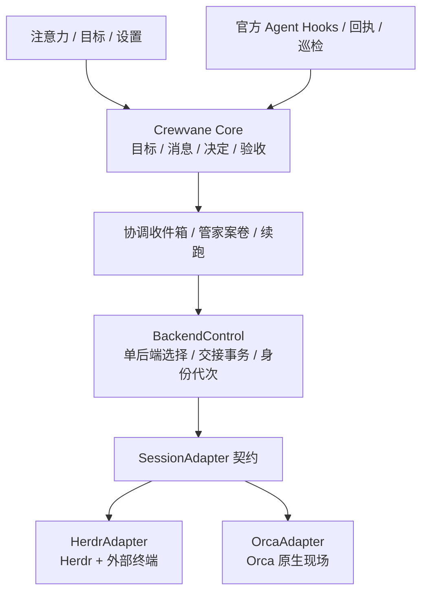

# Crewvane 0.11.0 开发规格：在设置中切换 Herdr / Orca

日期：2026-11-13。

实现时限：管家协调回合观察上限为 120 秒；恢复投递后最多再等待 60 秒取得
新现场或结构化协调证据。没有证据的已接受投递保持 `unconfirmed`，整个切换进入
`recovery_required`，不提前显示 ready，不另造请求重发。准备阶段等待原现场
静止仍为 30 秒，超时取消准备，不强制关闭。

交付类型：开发规格，不代表功能已经实现或 Orca 已经通过真实试用。

代码基线：Crewvane `v0.10.0`，提交 `ddf9cc268150e9b1c449449d42e7700587a7cc38`。

Orca 调研基线：`stablyai/orca v1.4.258`。它是本次核对版本，不是已经验收的兼容承诺。

验收合同：[0.11.0 场景与验收清单](../qa/session-backends-v0.11.0-acceptance.md)。

## 0. 开发前先读

本版只解决一件事：用户在设置中选择 Herdr 或 Orca，Crewvane 使用所选的一套会话后端完成管家协调、负责人执行与现场交互。

**用户已明确纠正：不是同时运行两套后端，也不是每个目标选不同后端。** 同一个 Crewvane 安装只有一个已生效的选择。两者可以都安装在电脑上，但 Crewvane 不同时向两套受管 Agent 派发工作。

本文中的 MUST / 必须是发布条件；SHOULD / 建议是实现建议；“待验证”必须按 G0 获取证据，不能自行当作已经支持。本文中的 TypeScript 接口、Crewvane 命令和文件名是本版待实现设计；附录 A 明确列出的 Orca 命令才是已核对的上游接口。不能把本文示例当成当前已经存在的 API。

执行顺序：先 G0 真实接口试验，再中性化会话层，再实现单后端切换，最后做界面与完整验收。G0 的必要能力失败时，允许完成无关的抽象，但不得假造能力、偷偷启用双后端、修改本规格语义或发布“Orca 已支持”。记录阻塞事实，再讨论替代方案。

开发从包含上述基线的干净 `codex/` 分支开始；保留原工作区的脏文件。本文存放位置所在分支可能早于 `v0.10.0`，不要据此从旧代码直接开发。

## 1. 产品决定与本版范围

### 1.1 已确定的决定

| ID | 决定 | 可观察行为 |
| --- | --- | --- |
| D01 | 后端在设置中二选一；应用级，不提供项目/目标覆盖 | 设置选 Herdr，则所有新的受管现场走 Herdr；切到 Orca 后统一走 Orca |
| D02 | 切换是显式交接操作 | 点击另一项先显示影响摘要，确认后执行；不静默搬运活跃会话 |
| D03 | 先确认旧受管会话停止，再创建新受管会话 | 新旧后端上不会同时执行 Crewvane 业务回合 |
| D04 | 业务事实只有一份 | 目标、消息、附件、注意力、决定、交付、验收仍由 Crewvane Core 保存 |
| D05 | 保留一个全局管家 | 每工作区只有一位有写入/派发资格的逻辑管家；切换会创建新的管家运行实例 |
| D06 | 管家只协调 | 所有实际执行仍交给独立负责人；不能因换后端让管家接管目标工作 |
| D07 | Orca 模式收薄现场功能 | Orca 原生窗口负责终端、完整聊天现场、代码与 Diff；Crewvane 保留注意力和验收 |
| D08 | 默认不变，切换自主选择 | 既有安装升级后仍选 Herdr；新安装默认 Herdr；Orca 为可选择的稳定后端 |
| D09 | 会话上下文可恢复时才恢复 | 保证恢复目标案卷；不承诺所有 Agent 跨后端续用原聊天会话 |
| D10 | 不自动故障切换 | Orca 故障时保留 Orca 选择和目标，用户可重连或显式切回 Herdr |
| D11 | 设置中可检查和更新 Orca | 与 Herdr 一样有明显的更新入口；只安装本版验证过的官方版本，不静默替换运行中的应用 |

“应用级”指本机本次 Crewvane 安装的所有已登记工作区。切换检查包含后台仍有受管会话的已登记工作区，不只当前屏幕上的一个。用户自己打开的 Orca、Herdr `default` Session 和其他未归 Crewvane 所有的终端不属于清理范围。不能为了实现二选一而关闭用户的其他应用或全局 server。

0.11.0 的范围包括：适配器、设置选择、Orca 接入与安装引导、安全切换、现场定位、受管启动与恢复、Hooks/巡检降级、后台性能和安装包回归。暂不实现远程 Orca、云 VM、手机端、插件市场、按目标后端选择、Orca Run/Task/Dispatch 双向同步或完整聊天记录搬家。

### 1.2 两种模式的功能归属

| 能力 | Herdr 模式 | Orca 模式 |
| --- | --- | --- |
| 注意力、待办池、目标记录、自然语言入口 | Crewvane | Crewvane |
| 管家协调收件箱、案卷隔离、语义状态和验收规则 | Crewvane | Crewvane |
| 真实 Agent CLI 与模型 | 用户已有 CLI 和配置 | 同一份用户已有 CLI 和配置 |
| 终端及完整现场历史 | Herdr + 外部终端；保留内嵌轻现场 | Orca 原生终端；0.11 不把 Orca UI 再嵌入 Electron |
| 代码、Diff、文件预览 | 已有工具 | 优先复用 Orca；Crewvane 不复制开发工作台 |
| 系统剪贴板、图片输入、现场快捷键 | 外部终端/Herdr | Orca 现场自行处理；Crewvane 不转发这些按键 |
| 本机 Agent 官方 Hooks | Crewvane 已有适配器 | 同一套 Crewvane 适配器，保护 Orca 自己的条目 |
| 运行状态采集 | Herdr 插件 + 补偿轮询 | Orca 可验证生命周期/身份查询 + 官方 Agent Hooks |
| 回执提醒、业务无进展、升级给人 | Crewvane | Crewvane；不能因为 Orca 有状态显示就删掉 |
| 历史目标的照片、附件与实际验收证据 | Crewvane | Crewvane |
| Herdr 专属插件和内嵌 PTY | 按原方式使用 | 不激活、不启动、不自动安装更新 Herdr |

轻量化首先是“少维护一套现场能力”，不承诺删除 Herdr 所需代码、不承诺包体和内存一定降低。Orca 原生 chat 仅作用户自愿使用的上游功能；首期受管 Agent 统一使用终端路径，保留任意 CLI、原生启动参数和 Hooks。

## 2. 用户交互合同

### 2.1 设置入口

在“设置 → 工作方式”第一张卡新增“执行现场”，展示两个互斥选择项 `Herdr`、`Orca`，附一句用途说明。只显示一个“当前使用”状态，不增加并行模式开关。

- Herdr：`在熟悉的终端中工作，支持内嵌轻现场。`
- Orca：`使用 Orca 的完整工作现场，Crewvane 聚焦目标与注意力。`
- 已安装但未选中的后端显示“可切换”，不是“运行中”。
- 选中未安装的 Orca 时进入安装引导，不立即保存为已生效后端。
- 点击另一后端弹出一次交接确认，显示涉及工作区数、未结束目标数、正在运行/无法确认的会话数；主按钮 `切换到 Orca` 或 `切换到 Herdr`。
- 确认文案：`将先停止原现场，再根据保存的目标记录在新现场继续。完整终端历史不会搬移；原 Agent 会话只在支持恢复时沿用。`
- 交接本身不要求填写表单，不要求人逐个复制任务。可展开查看每个目标的恢复依据和异常。
- 设置中的版本号继续显眼展示 Crewvane 版本；后端卡展示实际运行时版本、真实路径和兼容状态。

复用现有 UI 库、图标、间距和深浅主题；不用颜色单独表达状态。切换进度使用 `role=status`，错误贴近操作，键盘可选项、可取消准备，焦点返回选择卡。沿用像素品牌，不扩展第二套主题。

### 2.2 现场入口

| 当前选择 | “找管家” / “回到现场” | 设置中的现场选项 |
| --- | --- | --- |
| Herdr | 定位同一 Session 与真实目标 Tab，复用已有外部窗口 | 保留外部终端选择与内嵌轻现场 |
| Orca | 启动或唤醒同一 Orca runtime 的窗口，精确聚焦已登记终端 | 收起 Herdr 终端选择器，展示 `在 Orca 中打开` / `检测连接` |
| 切换进行中 | 展示当前交接进度，不启动旧或新业务任务 | 可继续查看和保存目标消息 |
| 连接失败 | 目标详情仍可打开，显示原因与 `重新连接` | 显示可切换到另一后端的入口 |

“打开成功”必须指实际定位指定现场。仅执行 `open Orca.app` 不算成功；不得打开任意最新 Tab 代替。反复点击已有现场不得创建新终端、负责人或项目。聚焦失败显示 `未能定位原现场`，可重试定位或进行显式恢复，不能暗中重建。

已完成/放弃的目标点击后仍打开记录；“重启目标”使用当前选中的后端，不为旧历史自动启动另一套后端。对不在当前 backend 上的历史现场，只展示历史来源，不提供会隐式启用旧 backend 的入口。

切换时没有自动恢复的待人决定/待验收/暂停目标，详情提供 `恢复并进入现场`。这是人明确发起的新恢复动作：在当前 backend 创建新 attempt，交接当前问题和相关证据后等待人的输入；保留原 attention ID、验收/暂停状态，不自动开始实现或验收。已经存在可核实现场时继续显示 `回到现场`，只负责聚焦。外部等待目标也可主动恢复用于咨询，但恢复动作本身不解除等待。

例如目标 A 正等待人确认方案：点击注意力 item 仍先看到问题和证据，点 `恢复并进入现场` 后打开 Orca 的 A 负责人终端，负责人只读取案卷并接收人的补充。人在现场明确答复并完成原有语义写回后，Crewvane 才更新注意力。该动作的初始化属于显式恢复许可，不能绕过自主暂停去执行任务。

### 2.3 新目标与既有注意力

一句话新目标、图片附件、先记下/我来做、自然语言补充、最新消息在上等既有交互保持可用。目标无需新增后端选择字段。

从 Orca 现场与负责人直接交互时：

1. 官方 Hook 有原始 Prompt / 回复时可保存为受限观测；不能据正文自动消除注意力。
2. 人的决定和业务结果仍通过 Crewvane 语义 CLI 写回，并绑定当次 attention / attempt。
3. 未写回的现场聊天无法被宣称已经同步；走一次回执提醒与管家核对。
4. 看过现场不等于处理完成；没有明确解决事实，原注意力继续保留。

## 3. 数据所有权与模块结构



图中两个 Adapter 都可安装，**BackendControl 任一时刻只授权其中一个执行；不是双路同时派发**。

| 所有者 | 持有事实 | 不承担的职责 |
| --- | --- | --- |
| Core | Goal、消息、附件、决定账本、授权、交付、验收、attempt | 不调用 Herdr/Orca 命令，不解析终端文字 |
| BackendControl | 当前选择、切换日志、安装配置、已登记工作区、执行代次 | 不推断目标是否完成 |
| SessionAdapter | 受管会话创建、身份核实、发送、观测、定位、恢复、关闭 | 不直接改 `state.json` |
| Agent Runtime Adapter | Codex/Claude/Cursor/Qoder/OMP 原生生命周期 | 不与 SessionAdapter 混为一种 Adapter |
| Skills | 角色、执行流程、接入和恢复说明 | 不作为送达确认、锁、迁移或验收权限的替代品 |

第一方实现建议放到新 Node 包 `packages/sessions/`，包名 `@crewvane/sessions`。它可依赖 core 的纯类型；core 不反向依赖它。Electron 和独立 CLI 复用同一个实现，不各写一套启动逻辑。平台调用、进程执行和文件存储用显式依赖注入，便于离线 fixture 测试。

Orca 的实验性 orchestration 不启用：不创建第二份 Run/Task，不安装其协调 Skill 来替代 Crewvane 管家，不让 `worker_done` 绕过 Crewvane 验收。必要的终端和生命周期能力走公开接口。将来引入原生消息能力应另行设计，不在首期顺带完成。

## 4. 中性数据与接口（本版待实现）

### 4.1 后端与现场

```ts
type SessionBackendId = "herdr" | "orca";

interface SceneReferenceV1 {
  version: 1;
  backend: SessionBackendId;
  installationId: string; // 当前 Crewvane 安装的非秘密稳定 ID
  runtimeId: string;      // 实测可重发现的 runtime 身份；不能仅用可执行路径
  runtimeGeneration: string; // runtime 重启/替换后变化
  bindingId: string;      // Crewvane 生成，不使用 UI 标题代替
  attemptId: string;
  backendEpoch: number;  // 设置切换代次
  locator:
    | { kind: "herdr"; session: string; workspaceId: string;
        tabId: string; paneId: string; agent?: string; processId?: number }
    | { kind: "orca"; repoId: string; worktreeId: string;
        terminalHandle: string; executionHostId: string; incarnationId?: string };
}

interface BackendControlV1 {
  version: 1;
  installationId: string;
  selected: SessionBackendId;
  epoch: number;          // 单调递增；切回旧后端也不复用旧值
  phase: "ready" | "switching" | "recovery_required";
  switchOperationId?: string;
}
```

`locator.kind` 必须等于 `backend`，禁止用 Herdr 的 session 字段塞 Orca ID。上游字段不存在时不能编造；缺少必要身份就标记不可验证，不向该终端发送或关闭。身份核实可以用已验证的进程出生标识/launcher 回执补足；具体映射在 G0 冻结。

上述 runtimeGeneration / incarnation 是本地去陈旧绑定所需的事实，不保证上游一定同名返回；G0 要给出能可靠构建它们的证据。只有标题、路径和 PID 数字不足以识别重启后复用的现场。

状态快照升级为 `WorkspaceState.version = 4`：增加中性的 `scene`、`concierge.scene`、`backendEpoch`、可选 `backendHandoff`。`AgentAttempt.scene`、`OwnerLaunchRecovery`、复核者现场和恢复元数据一并中性化。业务 `GoalStatus` 不新增“Orca 状态”。

### 4.2 Adapter 的最小契约

```ts
interface SessionAdapter {
  id: SessionBackendId;
  detect(): Promise<BackendDetection>;
  connect(input: RuntimeConnection): Promise<RuntimeIdentity>;
  create(input: CreateSceneRequest): Promise<CreateSceneResult>;
  inspect(scene: SceneReferenceV1): Promise<SceneObservation>;
  send(input: SendSceneRequest): Promise<SendReceipt>;
  focus(scene: SceneReferenceV1): Promise<FocusResult>;
  close(scene: SceneReferenceV1): Promise<CloseReceipt>;
  discover(input: OwnedSceneQuery): Promise<OwnedSceneMatch[]>;
  captureResume(scene: SceneReferenceV1): Promise<AgentResumeResult>;
}
```

G0 后必须把这些 DTO 定义成完整的可编译类型，并提交 JSON fixtures 与 parser；不能一路使用 `any`。类型必须包含下面的最低信息，方法名可按仓库风格调整，语义不得缩减。

| 类型/方法 | 最低字段与语义 |
| --- | --- |
| `BackendDetection` | 版本、路径、`missing/compatible/unverified/incompatible`、逐能力布尔值、原因 |
| `RuntimeConnection` | 固定本机运行时、真实 cwd、installationId；不接受 renderer 任意 URL |
| `CreateSceneRequest` | requestId、角色、goalId（管家初始化时无）、attemptId、backendEpoch、launcherPath；不含临时完整终端历史 |
| `CreateSceneResult` | `created/rejected/unknown`；真实 scene（若已获得）、恢复 ID、是否可能已经创建 |
| `SceneObservation` | 身份匹配、可达性、`working/idle/blocked/exited/unknown`、观测时间与来源；unknown 不能冒充 idle |
| `SendSceneRequest` | deliveryId、scene、业务正文或受校验文件、payload SHA-256；送达后不得换 ID 自动重放 |
| `SendReceipt` | `rejected/accepted/started/unknown`、上游 requestId、真实身份和时间；accepted 不等于开始，更不等于完成 |
| `FocusResult` | `focused/missing/failed`、是否实际导航；聚焦不创建新会话 |
| `CloseReceipt` | `stopped/already_stopped/unknown`、核实的身份与停止事实 |
| `OwnedSceneQuery` | installationId、requestId/bindingId、runtimeId；不根据同名终端认领 |
| `AgentResumeResult` | `supported/unsupported/unknown`，仅 supported 携带已核对的 Agent 种类/原生会话标识 |

业务发送失败必须区分“已知未接受”和“可能已接受”。进程超时、JSON 损坏、连接断开一律不能单独证明未送达。创建、关闭、派发均要保留诊断关联 ID。

### 4.3 本地文件与并发边界

在 Electron userData 根目录使用应用私有目录 `session-control/`（0700）：

- `backend.json`：唯一生效选择、epoch 和 phase，0600，原子替换。
- `workspaces.json`：本安装明确打开过、或 CLI 登记过的工作区 realpath 与受管资源索引，0600。不全盘扫描用户文件。
- `switch/<operationId>.json`：逐阶段日志、目标快照摘要、已核实关闭结果和恢复计划，0600。
- launcher 与一次性回执：独立私有目录；成功交接后保留必要身份记录，过期的正文/令牌按维护策略删除。

日志不保存明文 Hook token、凭据、完整 PATH、Prompt、工具输出或整份 workspace。工作区语义事实仍在各自 `.crewvane/`，不复制进注册表。

全局控制锁用于启动/发送/绑定/切换决策；各 workspace 继续使用原有状态锁。锁顺序固定为 `全局控制锁 → 按 realpath 排序的 workspace 锁`，外部进程调用不持有 workspace 锁。耗时调用采用租约 + 返回后重查 epoch 的方式；不得持锁等待 Agent 回合。

独立 CLI 从安装 wrapper 提供的受校验控制目录找到同一 `backend.json`，与桌面共享全局锁。语义读写不要求桌面进程常驻；后端选择只能由人的桌面设置改变。CLI 在切换期间仍可保存消息，禁止创建/发送/关闭业务现场；返回 `backend_switch_in_progress`。不得因 IPC 不可用私自退回另一后端。

上段限制针对普通 UI、队列、CLI 和 Agent 请求。切换执行器持有不可由 renderer/Agent 自行生成的内部 `SwitchAuthority`，绑定 operationId、阶段和允许的资源集合；它是下列阶段动作的唯一例外：

| 切换阶段 | 内部允许操作 | 普通调用 |
| --- | --- | --- |
| preflight / prepared | inspect、discover、captureResume；不发送核对或业务消息 | 保存消息、人的明确语义操作；不新建/投递/关闭现场 |
| quiescing / old_stopped | 只核实/关闭 prepared 清单里的旧现场；不创建或发送 | 同上；副作用排队 |
| committing | 仅做日志与状态提交，零后端业务操作 | 同上 |
| resuming | 只在新 backend 创建初始化管家、恢复计划内现场和发送对应 handoff；普通队列仍冻结 | 当前operation授权的新epoch/attempt可按原Core权限读取/写回自身案卷及登记运行；只有恢复scope内可launch，清单外launch/send/close仍拒绝 |
| ready | 内部例外结束 | 按新选择正常执行 |

`SwitchAuthority` 由可信控制服务校验当前日志后签发，通过现有受限 Host Bridge 向恢复案卷授权；不新增可由任意 CLI 填写的 `--force-switch` / `--switch-operation` 绕过入口。普通界面取消只取消观察或准备，不能声称已经撤销外部副作用。

resuming 的授权包含当前恢复案卷所需的 `progress/decide/wait/review` 等既有语义写回和 attempt/session 登记；仍需正常的角色、目标与业务校验，不能越权验收。旧epoch、其他案卷和普通新派发继续被拒绝。进入ready不等待负责人完成整个目标，只等待本轮恢复投递确认开始，或明确持久记录失败/未确认；未确认项留待核对，不自动重放。每管家案卷按120秒观察上限与串行规则执行，不能为恢复一个目标无限占住全部队列。

## 5. 安装、发现与启动

### 5.1 Herdr

保留当前随包分发的 Herdr 与安装路径优先级。只有选中 Herdr 或用户手动要求时，才连接/更新 Herdr、部署其插件或 attach PTY。应用启动若选 Orca，不先执行 `prepareHerdrCompanionsNow()` 再进入 Orca；CLI 与 Agent Hook 准备必须独立。

### 5.2 Orca

0.11 使用官方安装的独立 Orca 应用及其公开 CLI，不把另一套 Electron/源码打进 Crewvane，不维护 Orca fork。

检测结果只能处于以下四态。UI 必须逐态给出明确原因和下一步，不能把“找到文件”直接当成可用：

| 状态 | 判定 | 是否可设为当前后端 |
| --- | --- | --- |
| `missing` | 没有可确认的 Orca 应用和官方 CLI/runtime | 否 |
| `unverified` | 找到候选应用或 CLI，但来源、CLI/runtime 或所需能力尚未全部确认 | 否 |
| `incompatible` | 已确认是官方 Orca，但版本、应用完整性、签名或必需能力不满足兼容表 | 否 |
| `compatible` | 固定应用路径、版本、runtime 身份和 G0 必需能力均已验证 | 是 |

检测顺序固定为：检查已保存路径和标准安装位置 → 识别 bundle 身份与签名 → 解析应用内官方 CLI 或已注册 CLI → 查询同一 Orca runtime → 校验版本和能力。不能仅凭 PATH 中某个名为 `orca` 的文件认定是 stablyai/orca，也不得为此递归扫描整个磁盘。对用户已经运行的兼容 Orca 先复用，不能又启动第二份 `orca serve`。

当状态为 `missing` 时，设置卡片只提供三个主操作：

- `安装 Orca`：进入下述显式安装流程。
- `选择已有 Orca`：让用户选择应用或完整路径；校验成功后进入 `compatible`，失败则显示原因并保持不可选。
- `稍后`：关闭本次引导，保留当前已选后端和已有现场。应用重启后可显示一次未完成提示，但用户选择稍后后不能每轮反复弹窗。

`安装 Orca` 必须作为一个可取消的安装事务执行：

1. 只有用户主动点击后才下载；下载地址固定到经过兼容验证的官方 Apple Silicon Release，并在包内记录预期版本、文件名、大小和 SHA-256。默认不追随“最新版本”漂移。
2. 下载到 Crewvane 管理的临时目录；摘要、应用身份或代码签名完整性任一校验失败，就拒绝执行安装包并删除或隔离临时文件，不能激活后端。
3. 校验通过后打开 macOS 标准安装界面，由用户明确完成安装。不得静默复制、替换或覆盖 `/Applications/Orca.app`，不得清除 quarantine，也不得宣称摘要校验等于 Apple 公证。
4. 用户完成或取消安装后，重新检测实际落盘的应用和官方 CLI/runtime。只有新检测达到 `compatible`，才允许进入第 7 节的正常交接事务；不直接改 `selectedBackend`，安装弹出成功不等于选择成功。
5. 离线、下载被阻断、磁盘空间不足、摘要失败、签名失败、用户取消、安装后版本不兼容或 CLI/runtime 缺失时，都保持原后端选择、原目标和原现场不变；显示可执行的错误说明与 `重新检测`。
6. 自动安装不可用时，显示官方下载页和简洁的 macOS 手动安装步骤。用户也可以重新选择已有 Orca。不得要求 Homebrew、Node、终端命令或 `sudo` 才能完成常规安装。

应用存在但官方 CLI/runtime 不可用时保持 `unverified`，引导用户完成应用安装或修复入口；已安装版本不在兼容表内时保持 `incompatible`，可以提供官方升级入口，但不能静默升级、降级或覆盖用户应用。首次登录、Agent 原生信任和权限确认仍在 Orca 或 Agent 现场完成，Crewvane 只显示可操作指引。

Orca 在首期是额外安装的独立应用，不内嵌进 Crewvane。下载来源必须固定为官方 Release；校验记录必须包含来源、版本、摘要和实际应用签名状态。只有 `compatible` 检测结果可以成为当前设置；用户取消或任何校验失败都不能产生“部分切换”。

兼容表随 Crewvane 发布：起初只把实测通过的具体 Orca 版本列入 verified；其他版本显示“未验证”，可检测但不能直接派发。新版本只有在必需 contract fixtures 与真实烟测通过后才进兼容表。不编造 `>=1.4.258 永远兼容` 规则，也不因检查更新失败停止当前已验证版本。

设置卡同时提供 `检查更新`。有经过 Crewvane 验证的新版本时显示 `更新 Orca`，
沿用官方固定包下载、摘要/签名校验、标准安装与重新检测流程。上游存在但尚未
验收的版本只显示说明与官方页面，不能偷偷加入兼容表或自动升级。取消或失败
保留原选择。更新已选中的 Orca 时暂停新的派发；不得强行退出用户自建现场，
不得在旧运行时身份未核实前新建同名管家或重发任务。

## 6. 正常运行的唯一派发路径

### 6.1 创建和发送必须分开确认

`收到新目标 → Core 保存 → 协调收件箱入队 → 当前管家整理并委派 → owner launch → Adapter 创建现场 → 私有环境回执 → 绑定真实身份 → 发送一次任务 → 观测开始/保留未确认`。

必须先保存目标再执行副作用；UI 不能等 Agent 启动才显示目标。首次新建目标只联系工作区唯一管家；已有负责人收到补充时复用其现场。

`owner launch`、`verifier launch` 和现场恢复改用同一中性 Adapter。所有角色按用户完整命令启动，不根据 Orca picker 替换 CLI，不注入上游预填的 yolo、权限跳过、模型或沙箱参数。启动命令只有程序和原生参数；管道等复杂 shell 脚本继续由用户自己的脚本承载。

### 6.2 环境与自定义命令

每个受管启动导出：`CREWVANE_WORKSPACE`、`CREWVANE_GOAL_ID`、`CREWVANE_ATTEMPT_ID`、`CREWVANE_AGENT_NAME`、`CREWVANE_BACKEND`、`CREWVANE_BACKEND_EPOCH`，以及现有 Hook token 和 Host Bridge 上下文。管家使用独立的角色/案卷作用域；负责人不能继承管家 scope。

Orca 公共 `terminal create` 没有 POSIX `--env/--cwd`，所以用私有 launcher 在真实 interactive/login shell 里完成 cwd 与环境准备。只把正确转义的短 launcher 命令传给 Orca，任务正文放受校验文件；不用长串 `export` 作为一次终端键盘输入。

`.zshrc` 的 alias/函数必须在真实交互 shell 中解析；不要把命令预检写成“找不到可执行文件就拒绝”。生成器要保留 alias 的命令位置展开，不得用错误的 `exec`、整行单引号或 `command` 前缀使其失效。绝对路径/参数逐项安全转义。采用哪种 shell 调用只有在 G0 的 alias、函数、空格、中文和 argv 原样测试通过后才能冻结。

环境就绪用私有文件收据，绑定 installation、backendEpoch、attempt、launcher、真实进程身份。收据不能仅是 `ready=true`，也不能用终端上某行 marker 猜测。创建响应丢失时先按 launch request 和身份收据重发现；不立刻再建终端。

### 6.3 发送、原生状态与身份

- 任意发送前核对当前 backend、epoch、binding、attempt 与真实进程占用；不向退出后留下的 shell 发送任务。
- Orca 的 `orphaned=true` 只表示后台终端 leaf 未挂载到当前界面，不能据此判为不可达。发送仍核对 `connected`、`writable`、进程和 incarnation；聚焦使用 `terminal switch` 重新挂载同一个终端，不能重建现场。
- `accepted` 只表示输入被接受；未观测 `started` 时记为未确认，先核对，不能自动再发送。
- 若 Orca 支持当前命令的安全 retry-request，必须使用同一个上游 requestId、payload 和原进程代次；不重新构造新请求冒充重试。
- 创建和发送期间切换请求开始：等待现有租约结束或超时转未确认，再执行切换前置检查；不能一边切换一边继续启动。
- 同一个 request 的并发按钮、CLI 或管家重试，只能得到同一条 receipt/恢复状态。

### 6.4 状态与通信

归并优先级维持：`Crewvane 语义写回 > 当前 attempt 官方 Agent Hook > 后端生命周期 > Watchdog`。Orca 的 completed、waiting_for_input、unread 只进入运行观测，不直接修改 GoalStatus。

当前官方 Hook 覆盖范围保留；Hook 与 Orca 自己的配置按 marker 合并、保护用户条目，不重写用户 HOME、不复制凭据、不挪动原 Agent 会话目录。两边有重复生命周期时使用 attempt/turn/event/sequence 去重，业务语义仍只写一次。

无原生 Hook 的自定义 CLI，只报告可确认的进程与可达性，无法确认时 unknown；不能从屏幕文字猜测空闲。可信 Stop 保留 5 秒后一次提醒、再 30 秒交给管家；无 Hook 保留已验证的 90 秒 fallback；只有明确生命周期能启动 settled 计时。业务无进展阈值继续独立计算，工具/心跳不续命。

Agent 之间的受管协调经 Crewvane 的目标事实和消息投递通道完成；Orca 首期不要求启用自己的 Run/Worker 协议。Host Bridge 收口为中性场景操作；不能让 Orca 管家通过遗留 `CREWVANE_HERDR_BINARY` 调用未选中的 Herdr。

## 7. 单后端切换事务（必须严格实现）

### 7.1 可切换条件

切换前对所有已登记工作区与受管现场做预检。要求目标 backend 已安装且版本/必要能力验证通过；不能为了探测新 backend 提前创建新管家/负责人。

| 原现场/目标状态 | 是否继续交接 | 处理 |
| --- | --- | --- |
| 有 working 回合、队列正在 processing、或有效发送租约 | 暂不继续 | 最多异步等待 30 秒；仍未静止则退出准备，保留原选择，列出需要暂停/完成的会话 |
| blocked 或 unknown，无法确认是否仍在执行 | 暂不继续 | 提供打开原现场/重检；不能当作 idle，不能自动按 Enter/Esc |
| 原现场已确认不存在/停止 | 可以 | 根据最后一次可靠语义写回决定恢复，未确认工作不重放 |
| idle 且当前 turn 已有语义写回 | 可以 | 保存案卷与可验证的原生 resume 信息，进入停止步骤 |
| idle 但缺语义回执、存在 unconfirmed 投递 | 暂不继续 | 结束本次准备并解除冻结，提供 `请管家核对`；在原后端正常核对结束后重新发起切换；不能在冻结期偷偷投递核对消息 |
| 等待外部、待人决定/验收、暂停、backlog/manual | 可以 | 保留语义状态，迁移时不自动执行它们 |
| 未结束目标无现场、仅 pending 未发送 | 可以 | 保留队列，切换后新 backend 执行原队列项一次 |
| 登记工作区不可读/无权核实受管资源 | 暂不继续 | 原选择不变，展示具体工作区与恢复操作 |

等待 30 秒不是超时后强杀。用户可以取消准备；也可去原现场完成/暂停工作再切换。本版不提供未经核实的一键强杀迁移。

前置条件按“现场身份/是否静止 → 回执是否确认 → 业务恢复策略”的顺序判断。“等待外部/待验收可以切换”不允许跳过其仍然存活现场的 working/blocked/unknown 检查。无法确认的投递必须先核对；人的明确核对结论应保存原话和证据，不能仅点一下就把未知送达改成未发送。

### 7.2 事务阶段

切换日志必须持久化以下阶段。一个安装同时最多一个 switch operation；重复点击返回当前 operation。

| 阶段 | 操作与落盘 | 崩溃/失败后的恢复 |
| --- | --- | --- |
| `preflight` | 保存 from/to/operationId，冻结新启动和新投递；允许已有回合结束及语义写回 | 尚无外部关闭，失败/取消可解除冻结，原选择仍有效 |
| `prepared` | 核对全部资源，保存每目标 checkpoint、resume 能力、待发/未确认 receipt、关闭清单 | 不发送新任务；可恢复预检，不能从缺失字段猜测安全 |
| `quiescing` | 撤销旧控制作用域的写入与派发资格，依次关闭仅属于 Crewvane 的旧管家/负责人/复核者，逐项保存确认结果 | 部分关闭时进入 recovery_required；不能装作已回滚或自动创建新现场 |
| `old_stopped` | 再核实旧受管执行现场全部 stopped/already_stopped，无未确认关闭 | 尚未启用新 backend；可继续提交或明确选择恢复原 backend |
| `committing` | 每工作区写入新的 backendEpoch/历史场景/恢复计划；逐项记录结果；最后原子提交 backend.json 的新选择和 epoch | 这是多文件事务日志恢复，不是假设多文件 rename 原子；phase 未 ready 时禁止普通队列派发 |
| `resuming` | 连接新 backend；持 SwitchAuthority 先初始化唯一管家，再按恢复计划串行通知；负责人仍可按目标并行 | 单目标失败保留恢复记录；无跨 backend 自动回退；已接受项不再自动发；不解冻普通队列 |
| `ready` | 汇总恢复结果，解冻未发送队列；清理敏感临时文件 | 新选择生效；个别恢复失败目标仍可重试核实，不回滚整个配置 |

旧作用域撤销后，所有受管 CLI 变更必须校验安装 epoch、当前目标 attempt 与管家 scope generation。迟到回执只进有界诊断，不能结束新目标、清除新注意力或启动旧后端。epoch 约束保护的是 Crewvane 受管 API，不是 OS 沙箱，不声称阻止任意 CLI 直接读写文件。

新 backend 启动失败：若尚未提交选择且旧现场均未关闭，可取消；一旦已经关闭部分旧现场，就显示 `交接未完成`，保留日志，提供 `重试交接` / `恢复原后端`。恢复原后端是一个新的受控恢复操作、使用新 epoch，不复活旧令牌、不自动重发未知结果。用户无需手工改 JSON。

### 7.3 恢复计划的精确定义

每个未结束目标持久保存 `backendHandoff`：operationId、源 scene/attempt、checkpoint revision、最新语义写回时间、原投递结果、可用 resume 元数据、恢复方式、恢复 receipt 与错误。

通用恢复方式为 `case-rehydrate`：新建 Agent attempt，把目标原文、最新消息、委托边界、最新交付/证据位置、决定账本、方法解析和下一步交给新负责人；要求先核对磁盘成果再继续。不是把全部历史终端和所有目标注入新上下文。

只有 Agent 原生会话标识已取得、恢复命令已验证且当前 backend 支持时才用 `native-resume`。UI 显示“已恢复原会话”或“已根据目标记录继续”，不能混用。关闭 Orca 终端可能清除其保存的 resume/layout 信息，必须先获取可验证信息；拿不到时明确使用 case-rehydrate。

| 目标种类/状态 | 切换成功后的自动行为 |
| --- | --- |
| active 且原回合已语义写回，有明确下一步且未暂停 | 给新管家一条 handoff 通知；核对已有成果后继续，不重放旧 Prompt |
| pending 且从未发送 | 原请求保留身份，在新 backend 发送一次 |
| waiting（外部） | 不创建负责人，不改变提醒；到期按现有规则处理 |
| 有未解决 attention / review / 自主暂停 | 保留事项，不自动继续执行；需要答复时才恢复现场 |
| completed / dropped | 不启动任何 Agent；历史仍可查看 |
| backlog / manual | 只保留记录，绝不因切换启动 Agent |

同一注意力 ID 不因切换重新生成，不重发相同企微/Webhook；恢复现场的新 attempt 不代表新决定。续跑租约必须在切换屏障内失效或安全结束；解冻时从当前修订重新评估，不沿用旧 backend 的执行资格。

prepared 的 checkpoint 不是冻结用户数据：切换期间人仍可补充消息、明确结束/放弃或解决决定。resuming 每个目标前重新读取最新 revision，并据当前状态重算恢复策略；已经结束的目标跳过，新增消息按原 ID 合并，不能用 prepared 快照覆盖。当前目标在创建恢复现场期间被人结束时，停止投递并只清理这次核实拥有的新现场。

committing 也必须调用 Core 在最新 workspace 上只更新后端/交接字段；prepared 快照只作审计与恢复依据，禁止整库替换当前快照。恢复的 Prompt 在即将发送前检查 goal revision，过时则重建上下文；若已经可能发送，就记录未确认并等待本次结果，不能为“更新上下文”重发整段任务。

## 8. 存储升级、回退与已有数据

首次打开有效 v3：在原 workspace 锁内先写一次 `.crewvane/state.v3.backup.json`，校验备份成功后迁移到 v4。保留原目标 ID、状态、注意力 ID、决定、消息、附件、委托、方法和通知去重身份。现有 Herdr 引用转换为 backend=herdr 的历史/当前场景，无法核实的运行身份只标为需重连，不凭迁移产生“运行中”。

迁移是离线可执行的，不能为填满 `SceneReferenceV1` 而生成伪造的 runtimeId/generation：先将原引用原样放入只供 legacy converter 读取的 `legacyScene`（版本0、backend=herdr、unverified），未核实前 `scene` 留空。首次连接在原Session核对工作区、真实Agent/前台进程、目标attempt与已有回执后，才生成完整中性scene；失败保留原记录与重连入口。历史记录可保留未验证来源，不获得发送/关闭权。升级时导入安装保存的当前/最近工作区索引，之后只登记明确打开过的根，不声称已经发现磁盘上所有旧工作区。

不把有价值的 v3 作为“不兼容垃圾”整库归档重建。默认选择 Herdr；Core 与快照校验、恢复策略必须明确识别 v4。未来版本或损坏快照按已有恢复协议处理，不能伪造迁移成功。

一旦 v4 已发生新操作，不能用 v3 备份直接覆盖回滚，否则会丢用户新消息。0.11 的“切回 Herdr”仍使用 v4；安装旧版应用不被宣传为安全回滚路径。提供备份位置和清晰版本提示。

在 0.10.0 的源码中，`HerdrReference`、`Goal.herdr`、`WorkspaceState.concierge`、`AgentAttempt.scene`、复核与启动恢复、`herdr.ts`、`main.ts`、`owner-launch.ts`、`owner-attach.ts` 和 CLI `session set` 均有真实耦合。此前“已经是可替换 Adapter”只是架构意图，不能当作本版已经具备的基础设施。

迁移完成后 Herdr 私有字段只允许出现在 legacy converter、HerdrAdapter、Herdr 插件和专项测试中；通用 UI、Core 规则、协调器、Hooks broker 和独立 CLI 路由不直接调用 Herdr 类。

## 9. 错误、清理与性能

### 9.1 稳定错误与恢复入口

| code | 含义 | UI 操作 |
| --- | --- | --- |
| `backend_missing` | 所选后端未安装/路径失效 | 安装或选择已有应用 |
| `backend_unverified` / `backend_incompatible` | 未验证版本/明确缺必要能力 | 查看版本说明，选择受支持版本 |
| `backend_unreachable` | 原运行时不可达 | 重新连接，不另开同名运行时 |
| `backend_switch_in_progress` | 正在交接 | 显示进度，消息仍保存 |
| `backend_busy` | working/blocked/unknown 无法安全切换 | 列出现场，完成/暂停后重试 |
| `scene_identity_mismatch` | 旧 ID、不同进程/工作区/代次 | 只读诊断，重新核实绑定 |
| `launch_unconfirmed` / `delivery_unconfirmed` | 可能已创建或送达 | 核对已有现场与 receipt，禁止盲重发 |
| `focus_failed` | 未精确导航 | 重试定位；恢复需显式动作 |
| `switch_recovery_required` | 部分旧现场已停，交接未完成 | 重试交接或恢复原后端 |
| `stale_backend_epoch` | 旧后端迟到的受管请求 | 拒绝写入，记录有限诊断 |

### 9.2 生命周期和清理

关闭 Crewvane 窗口继续采用原隐藏行为，不停止后台任务；退出进程与关闭现场窗口不能被混为一件事。切换后停止旧适配器监听、计时器和轮询，但保留用户手工创建的资源。旧 backend 的低频健康检测只能由显式设置查看触发，不在后台持续轮询未选 backend。

结束目标时只关闭它的真实负责人/复核现场；先保存目标与证据，再清理上游临时资源。Orca terminal close 可能删除其终端历史，不能把它作为唯一交付证据仓库。删除已结束目标时，Crewvane 附件清理沿用现有规则；不删除用户项目和 Orca 全局资料。

每个 runtime 每 10 秒最多一组状态查询，按一批结果派生全部目标；失败退避到 30/60 秒，人工重连可立即探测。优先真实事件，事件不可用才补偿轮询。不为每个目标每秒 spawn 一个 CLI，不把 revision/标题动画当作进展。

相同状态/可达性不落盘；事件有界去重；目标原始回复继续遵守 12,000 字符与 SHA-256 限制；不保存终端全文。现有 events.jsonl 轮转和缓存维护继续覆盖新增目录，switch 最终日志只保留最近 20 次/30 天，未完成事务不清理，敏感临时正文终态后 24 小时清理。

UI IPC 全异步；检测/聚焦/关闭不跑同步 AppleScript 或 execSync。切换中的长操作不会禁用整个应用；只阻止冲突派发。三目标并行和关闭现场后的点击响应必须实测。

## 10. 开发切片与交接要求

每片完成都提交对应测试与证据，不把所有文件一次改完再测。建议文件位置是预期职责边界，不允许为了凑文件名复制一套业务状态机。

| 切片 | 输入与要做的事 | 主要文件范围 | 完成条件 |
| --- | --- | --- | --- |
| G0 接口试验 | 冻结 Orca 公开命令、响应、shell、聚焦、身份、停止与恢复事实 | `docs/research/orca-session-contract.md`；隔离 fixture 和试验脚本 | 附录 B 全部必要门禁有真实证据；未知项不得写成支持 |
| S1 中性类型与 v4 | Scene、epoch、作用域校验、v3 迁移，不改变业务语义 | core types/store/service/scene；对应 test | 迁移保留数据；旧 epoch/attempt 拒绝；业务状态不看 backend 名称 |
| S2 HerdrAdapter | 提取现有启动/发送/聚焦/恢复，统一 CLI/Desktop | 新 `packages/sessions`；现有 herdr、owner launch/attach、external-terminal | 现有 Herdr 全套回归通过后再接 Orca |
| S3 OrcaAdapter | 按 G0 契约实现检测、folder 关联、launcher、身份、收据、精确聚焦 | `packages/sessions/src/orca/`；中性 Host Bridge | 无 Herdr 连接也可完成目标；不启用 orchestration；不改全局 Agent 默认值 |
| S4 切换事务 | 全局配置/注册表/锁、逐阶段日志、停旧启新与崩溃恢复 | `packages/sessions/src/control/`；desktop 协调与 scheduler | 两个方向、每阶段崩溃、未确认消息都通过验收 |
| S5 UX 与轻量化 | 设置二选一、安装引导、切换摘要、模式驱动现场入口 | Settings、GoalDetailService、preload/api、终端入口 | 深浅色/键盘/忙时反馈；Orca 模式不启动内嵌 Herdr PTY |
| S6 Skills/Hook/文档 | 中性角色说明、按后端恢复说明、技能安装 eval、完整文档索引 | skill-registry、外部 skills、Hook broker、CONTEXT、ARCHITECTURE、README 中英文 | Orca 管家收到中性协议，不再指导它执行 Herdr 命令 |
| S7 打包与发布验收 | 实机双向切换、性能、DMG/ZIP 下载复验 | scripts、QA、版本与 release workflow | [验收合同](../qa/session-backends-v0.11.0-acceptance.md) 全部必选通过 |

执行 S1 前先列出仓库所有 `HerdrReference`/`.herdr`/`HERDR_` 调用者，归类为迁移、适配器或待消除耦合。S6 必须同步更新 `CONTEXT.md` 中“全局管家在 Herdr 中持久存在”等旧定义与 [插件架构](plugin-architecture.md) 的适配器描述。本次文档任务不提前改这些当前版本事实。

每片交接使用固定格式：范围、实际修改文件、接口变化、真实运行的命令和结果、证据位置、仍未验证项。G0 以外出现接口证据与设计冲突时先补 G0，不让模型猜一个新 flag 继续开发。

## 11. 发布与完成标准

0.11.0 必须作为“设置选择一套后端”的完整功能发布，不能以只接入 Orca 状态查询或只打开其应用窗口代替。必须同时满足：

- Herdr 作为当前选择时，原有完整目标链路可用。
- Orca 作为当前选择时，即使 Herdr 不存在/无法启动，完整目标链路仍可用。
- 两个方向都能安全交接，旧受管业务进程停止后才启动新后端；无重复派发。
- 目标、消息、注意力、决定、证据、方法、通知和自主授权在切换后保持。
- 任意未知 CLI、原生 Hook 缺失、上游重启、切换中崩溃均有明确恢复路径。
- 通过发布包真实模型试用，不能只用 mock 或由脚本预建负责人后宣布管家分发成功。

开发完成才提升根 package、CLI、desktop、Herdr plugin 和版本相关文档到 `0.11.0`，检查不存在 `SkillRegistry` 默认版本等隐藏旧值。执行已有完整门禁及新增脚本。发布 PR/合并/Release 时按当次授权执行，重新下载公开 DMG/ZIP，核验 SHA-256、quarantine、严格签名、CLI、所选后端和恢复。未 Apple 公证时不能宣称已公证。

## 附录 A：官方证据与已核对命令

以下是阅读官方版本化文档/源码得到的事实；不是实际运行验收。后续开发仍要以实测 JSON schema 冻结字段。

| 来源 | 本次确认的有限事实 |
| --- | --- |
| [Release v1.4.258](https://github.com/stablyai/orca/releases/tag/v1.4.258) | 2026-11-13 的正式发布版本 |
| [CLI reference](https://github.com/stablyai/orca/blob/v1.4.258/docs/site/content/docs/cli/reference.mdx) | CLI 控制运行时，支持普通 folder 接入与 terminal 操作 |
| [terminal handlers](https://github.com/stablyai/orca/blob/v1.4.258/src/cli/handlers/terminal.ts) | create 的公开选项与 focus 返回值需按实际处理 |
| [send spec](https://github.com/stablyai/orca/blob/v1.4.258/src/cli/specs/terminal-send.ts) / [send handler](https://github.com/stablyai/orca/blob/v1.4.258/src/cli/handlers/terminal-send.ts) | `wait-submit` 与 `retry-request` 有具体适用条件 |
| [runtime terminal contracts](https://github.com/stablyai/orca/blob/v1.4.258/src/shared/runtime-terminal-contracts.ts) | handle/执行身份相关结构，不代表每版本每路径都返回完整字段 |
| [folder mutations](https://github.com/stablyai/orca/blob/v1.4.258/src/cli/handlers/folder-workspace-mutations.ts) | folder 的独立 activation 路径有限制，精确聚焦须实测 |
| [Terminal](https://github.com/stablyai/orca/blob/v1.4.258/docs/site/content/docs/terminal.mdx) | 使用 xterm；普通 shell 配置不能直接外推到 Agent 启动 |
| [Supported agents](https://github.com/stablyai/orca/blob/v1.4.258/docs/site/content/docs/agents/supported.mdx) | 支持任意 CLI；预配启动的权限默认值需避免隐式继承 |
| [Session restore](https://github.com/stablyai/orca/blob/v1.4.258/docs/site/content/docs/model/session-restore.mdx) | 应用退出、daemon 退出与主机重启是不同恢复场景 |
| [Orchestration](https://github.com/stablyai/orca/blob/v1.4.258/docs/site/content/docs/cli/orchestration.mdx) | 独立实验编排层，首期不接入其 Task/Run 状态 |
| [Remote servers](https://github.com/stablyai/orca/blob/v1.4.258/docs/site/content/docs/remote-servers.mdx) | 有无窗口模式；不得为同一设置重复启动 runtime |

已核对命令形状（`<...>` 是上游真实返回的值，不是让模型推测 ID）：

```text
orca status --json
orca open --json
orca repo list --json
orca repo add --path <absolute-folder> --kind folder --json
orca worktree ps --json
orca worktree show --worktree <explicit-selector> --json
orca terminal create --worktree <explicit-selector> --title <title> --command <launcher-command> --json
orca terminal list --worktree <explicit-selector> --json
orca terminal show --terminal <handle> --json
orca terminal send --terminal <handle> --text <text> --enter --json
orca terminal switch --terminal <handle> --json
orca terminal close --terminal <handle> --json
```

禁止虚构：`terminal create --env`、POSIX `--cwd`、`--shell zsh`、外部终端 `orca attach`、未经源码核对的通用 deep link、`--no-yolo` 等参数。不能把内部 Electron/RPC 类型当公开 CLI。

## 附录 B：G0 必需证据表

| 门禁 | 真实试验 | 失败后的规则 |
| --- | --- | --- |
| G01 | folder 模式：个人事项目录、含多仓根、项目目录都能创建/查找终端，不自动创建 Git 分支或 worktree | 不靠随意建 Git repo 绕过；记录限制并修改设计后再实施 |
| G02 | 从其他项目/窗口聚焦 folder 内指定 terminal，`focus.navigated` 为真；20 次点击不重复创建 | 只有 open app 成功不算通过；阻塞 Orca 现场入口发布 |
| G03 | Finder 路径启动，zsh alias/函数 `cursor-2`、完整 argv/cwd/长 PATH、20,000 字目标和中文空格路径都正确 | 不替换成另一个 Agent 命令掩盖失败 |
| G04 | 创建响应丢失能用请求/私有回执找回同一现场；发送超时不重复；重启后不会误认旧 handle | 缺身份保证就保持 unconfirmed，禁止自动认领 |
| G05 | 默认上游权限参数、Hook/用户配置不被改动；原生 resume 获取不到时 case-rehydrate 仍可继续真实目标 | 原会话恢复标 unsupported，不虚报原上下文无损 |
| G06 | 关闭旧受管 terminal 后核实进程停止，保持用户自己的终端；停止先于新后端启动 | 不能只看 exit=0；阻塞切换发布 |
| G07 | Orca 图形现场真实文字/图片输入和快捷键可用，关闭 UI 与退出 daemon 分别验证 | 记录 Agent/输入限制，必要能力失败则不能用“Orca 已完整解决”宣传 |

G0 输出：固定上游版本/commit、精确命令参数、脱敏 stdout/stderr fixture、关键字段解释、运行身份/环境收据格式、时间线、平台与 Agent 版本、每项 pass/fail，以及真实界面证据。不得只写“看起来支持”。
